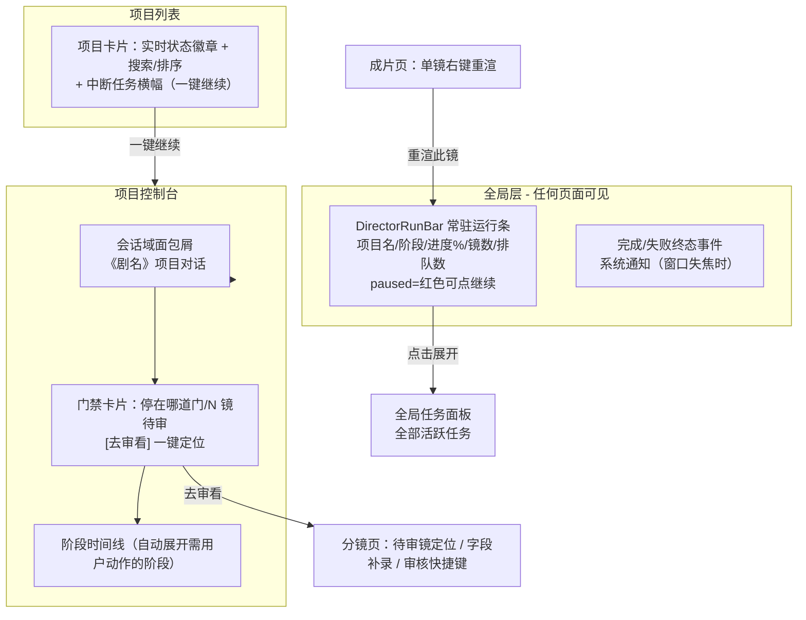
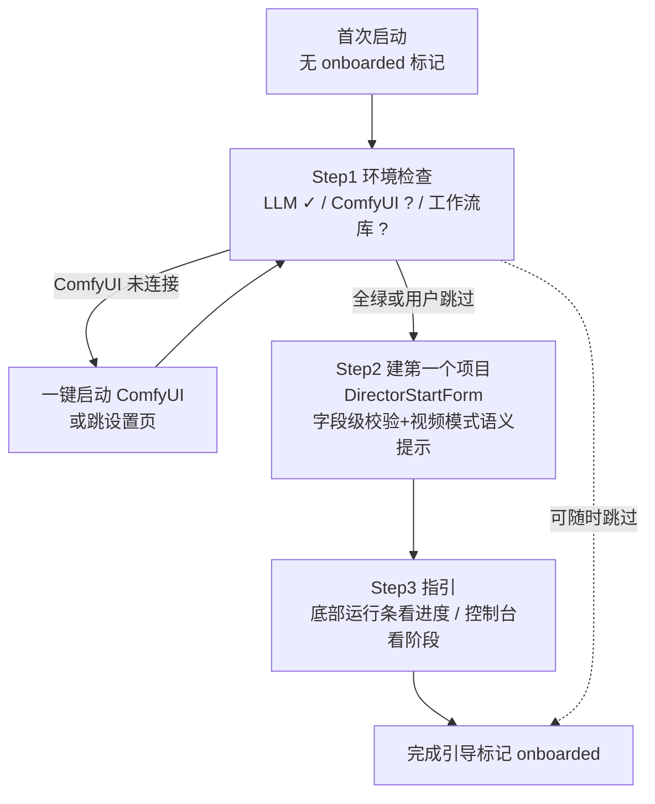

# 交互整改需求方案（drama-studio，2026-10-30）

> 读者：项目所有者（可对照代码与验收）。
> 证据基线：5 份只读深读报告（renderer-core / renderer-assets / main-process / industry-patterns / docs-coverage，均 2026-10-30）。本文不新增未经验证的断言；标「待核实」的条目动手前需对照源码确认一次。

---

## 〇、摘要

- **现状一句话**（引自 docs-coverage ⑥）：项目处于「**核心功能链已跑通且工程地基（四门验收/架构拆分/安全边界）已收敛完毕，进入体验层最后一公里**」阶段；遗留问题从 85 项基线收敛为约 35 项，交互侧真正未闭环的是**首跑引导、门禁-开关联动、中断续跑入口、状态可见性（常驻状态条/日志面板）、审核效率**这五组。
- **本方案定位**：本方案是《交互整改清单-2026-10-18》的接力，不重复其已整改的 21 个交互节点（确认框统一/取消哨兵/全局兜底等，见 docs-coverage ② DC-DONE-01~05），也不重复 efficiency-audit / remediation 波次已验收项（DC-DONE-06~61）。本次聚焦**更深一层**：主进程交互契约偏瘦（队列不可观测、门禁无结构化负载）、跨视图状态一致性、首跑与恢复引导、以及 12 个从未被任何审计覆盖过的交互空白维度。
- **方案统计**：共提出 **20 条整改需求（REQ-01~REQ-20）**，其中 **P0 × 5 / P1 × 9 / P2 × 6**。

---

## 一、现状与问题清单（含证据）

> 编号沿用 5 份 findings 原编号；每条标注与既有审计的关系。**DC-DONE 已落地项一律不再列出**。

### 1. 信息架构与导航

| 编号 | 问题 | 证据 | 优先级 | 与既有审计关系 |
|---|---|---|---|---|
| RC-02 | 全局 `/console` 与 `/project/:id/console` 会话域分裂，UI 无「当前对话属于哪个项目」明示 | `router/index.ts:20/:28` 双路由并存；`ConsoleView.vue:194-196` `chatScope = projectId \|\| 'global'`；模板 :4-52 无项目域名展示 | P1 | **1019 UX-P1-02 残留（DC-OPEN-01 未修）** |
| RC-10 | 控制台中栏模块切换（activeModule）不持久，切页即丢回「工作流监控」 | `ConsoleView.vue:198` `ref('workflow')` 无持久化 | P2 | 本次新发现 |
| MP-10 | 无全局并行任务列表：`getLatestState()` 只返回最近一个活跃任务，并行跑 2 个项目时另一个进度无处可看 | `directorStateMachine.ts:192-204`；缺 `director:listActiveStates()` | P2 | 本次新发现 |
| DC-OPEN-27 | 项目列表无搜索/排序/首帧缩略图 | 开发补全需求文档 §三 P3-4（首提，未实施） | P2 | 本次首次转为需求 |
| RC-05 | DirectorFlow 整套进度面板已成死代码残留（`progressVisible` 无任何置 true 点），维护者会误判列表页还有进度/重试入口 | `DirectorFlow.vue:21-28,166,217,272`；`:201-217` 订阅无效 | P2（代码卫生） | 1019 UX-P0-02 **已修后的残留** |

### 2. 创作工作流引导与首跑

| 编号 | 问题 | 证据 | 优先级 | 与既有审计关系 |
|---|---|---|---|---|
| DC-OPEN-04 | 无首跑 SelfCheck 向导（LLM/ComfyUI/工作流 checklist），SelfCheckPanel 需用户自行点开 | efficiency-audit UX-P2-09；remediation-plan §5 明确推后 | P2（关联度高） | 本次升级为 P1 需求 |
| DC-OPEN-20 | ComfyUI 未启动时无友好引导弹窗 + 无「一键启动 ComfyUI」按钮；与 DC-DONE-14（侧栏跳设置）不同层次 | 开发补全需求文档 §三 P2-1 | P2（关联度高） | 本次升级为 P1 需求 |
| RC-11 | 开拍单校验仅 toast，无字段级红字定位与聚焦 | `DirectorStartForm.vue:10,13,36` 未绑 el-form rules；`:175-178` 手动 warning | P2 | 本次新发现 |
| RC-15 | 开拍单「有视频」模式语义未说明：选好的视频仅用于拆剧本、不进入成片，tip 未告知 | `DirectorStartForm.vue:27-35,57-59,179-185`（submit 不含 videoPath） | P2 | 本次新发现 |

### 3. 长任务进度可见性与中断恢复

| 编号 | 问题 | 证据 | 优先级 | 与既有审计关系 |
|---|---|---|---|---|
| MP-01 | 队列不可观测：无「当前队列内容/在渲哪镜/排队镜数」查询通道；`TaskQueue.queue` 是 private，前端只能拿增量事件 | `taskQueue.ts:58,484-486`；缺 `queue:list` / `queue:status` | **P0** | 本次新发现 |
| MP-06 | 无 ETA：`ProgressEvent.etaSeconds?` 契约字段存在但全代码库从未填充（所有 emitProgress 调用点均不传） | `ipcTypes.ts:224`；`taskQueue.ts:673,920,935` | P2 | 本次新发现 |
| MP-09 | 双进度契约不统一：流水线态 `director:progress` 全量快照 + 队列态 `project:progress` 单镜事件并行，前端自行合并（历史出过 doneShots 虚增 bug） | `directorStateMachine.ts:106-114`；`directorProgressBridge.ts:132-133` 注释 | P2 | 本次新发现 |
| MP-12 | 无「任务完成/失败」终态事件，前端只能 diff 快照里 running 翻转推断，易漏触发完成通知 | 终态混在 `director:progress` 快照（`directorFinish.ts:42`）；缺 `director:finished` | P3 | 本次新发现 |
| RC-14 | 队列页重进后「渲染中」镜头进度归零显示 0%（事件间隙内疑似卡死错觉） | `QueueView.vue:241-244,329-335,337-344` | P2 | 本次新发现 |
| DC-OPEN-15 | 重启后残留任务：recoverAll 已降级中断态（DC-DONE-41），但用户仍看到「running 挂死」，缺「从失败阶段继续」一键入口与明确中断提示 | 开发补全需求文档 §三 P0-3 | **P0** | DONE 项留下的交互断层，非重复项 |
| DC-OPEN-24 | 导演控制台无常驻状态条（阶段+进度%+已完成/总数+ETA，paused 红色高亮可点继续） | 开发补全需求文档 §三 P3-1 | P3（关联度高） | 本次升级为 P0 需求 |
| MP-05 | 无「一键继续中断任务」通道：续跑必须 UI 自行组织 `resumeFrom(projectId, interruptedStage)`；多中断项目无统一「待恢复任务」入口 | `render.ts:82-84`；`directorStateMachine.ts:285-319` | P1 | 本次新发现 |
| MP-07 | 无 ComfyUI 连接状态变化事件；渲染中掉线只表现为超时错误从 progress 冒出来，UI 无即时感知 | `preload/index.ts:49-51` 仅轮询；缺 `comfyui:status-changed` | P2 | 本次新发现 |

### 4. 门禁与审看 UX

| 编号 | 问题 | 证据 | 优先级 | 与既有审计关系 |
|---|---|---|---|---|
| MP-02 | 无结构化「门禁待处理」负载：未审镜编号拼在 `stages.render.message` 字符串里且只列前 5 个；`DirectorState` 无待审镜清单字段 | `directorStateMachine.ts:178-182`；`ipcTypes.ts:976-1006`；缺 `pendingGates: {stage, unreviewedShotIds[]}` | **P0** | 本次新发现 |
| RC-03 | 审批门禁 warn 模式在控制台/队列页仅 toast 放行，不列出未审镜号、无二次确认，未审首帧即烧 GPU | `ConsoleView.vue:283-286`（rerenderOneShot）；`QueueView.vue:368-370`（retryShot 同款） | P1 | **1019 UX-P1-05 残留（DC-OPEN-03 未修）**；分镜页侧待核实 |
| RC-04 | 门禁暂停后「去哪审、审什么」无指向性引导：暂停告警无入口，审看入口分散在另一个阶段的折叠区，停在 render 时 scenes 阶段默认收起 | `WorkflowPanel.vue:45-53`；`StageTimeline.vue:122-133,218-243`；`ShotRenderList.vue:33` | P1 | 本次新发现 |
| RA-03 | ShotReviewDialog 核对清单要求的 shotSize/camera/emotion 字段在 ShotEditDialog 无录入入口，手动新建分镜永远挂红 ⚠，清单可信度受损 | `ShotReviewDialog.vue:25-27,32-39,56-59`；`ShotEditDialog.vue:254-276,478-508` 无此三字段（主进程 LLM 拆分是否写入**待核实**） | P1 | 本次新发现 |
| RA-04 | 页头「全部通过」一键放行全部审核镜、无确认——绕过 shotReviewGate='block' 硬门 | `StoryboardHeaderBar.vue:18-20`；`StoryboardView.vue:180-191` 无 confirmDanger；门控设置 `SettingsView.vue:113-119` | P1 | 本次新发现 |
| DC-OPEN-13 | 「一口气跑到底」开关（gateStages=[]，DC-DONE-59 已落地）与 shotReviewGate 未联动：开开关后本项目门禁状态无常驻显示 | 开发补全需求文档 §三 P0-1 | **P0** | 本次升级需求 |
| DC-OPEN-25 | 分镜审核面板无键盘快捷键（→ 下镜、Enter 通过）、无重出时调 seed | 开发补全需求文档 §三 P3-2 | P3（关联度高） | 本次升级为 P1 需求 |
| DC-OPEN-14 | 导演对话「继续」指令覆盖率不足：paused 状态 fallback 自动 resume、日志区分未做 | 开发补全需求文档 §三 P0-2 | **P0** | 本文并入 REQ-03 一并覆盖 |
| RA-07 | 分镜表格「⚠ 待整改」标签 cursor:pointer 但无点击处理——死 affordance | `ShotTablePanel.vue:89-91` | P2 | 本次新发现 |

### 5. 预览与迭代闭环

| 编号 | 问题 | 证据 | 优先级 | 与既有审计关系 |
|---|---|---|---|---|
| RC-09 | 成片页无「单镜不满意 → 去改」回跳入口：仅空态有 CTA，有产物时剪辑台只能 trim/跳过/转场，审片→修改要多切 2-3 跳 | `ResultView.vue:51-56,33-152`；闭环仅存在于 `ShotRenderList.vue:96-106` | P2 | 本次新发现 |
| RA-02 | ShotEditDialog「试听」按钮是哑按钮：调了 `tts.preview` 后不播放、成功无 toast；与角色页全屏 loading+audio 播放器割裂；「跟随角色音色」时无法试听继承音色 | `ShotEditDialog.vue:331-341,73`；对比 `CharacterView.vue:364-378,142-145` | P1 | 本次新发现 |
| RC-06 | 批量重渲部分失败仍无条件报成功 toast，失败镜被漏跑 | `ConsoleView.vue:301-312`（:308 无条件 success） | P2 | **1019 UX-P2-07 残留（DC-OPEN-06 未修）** |
| RC-08 | DirectorFlow.locateFinal 未 await/未 try/catch：成片被移动后错误落到全局兜底，无「成片文件不存在或已被移动」引导文案 | `DirectorFlow.vue:265-269`；对比 `useDirectorState.ts:311-318` | P2 | **1019 UX-P2-10 残留（DC-OPEN-10 待核实）** |

### 6. 错误与失败恢复

| 编号 | 问题 | 证据 | 优先级 | 与既有审计关系 |
|---|---|---|---|---|
| MP-03 | 暂停只能停在阶段边界，无法挂起/恢复进行中的单镜渲染；中断单镜只能 cancel（kill 该镜并回退 pending），长镜头中途想停要白等或白扔 | `directorAgent.ts:250-256`；`directorStateMachine.ts:130-149`；`taskQueue.ts:227-233,1265` | P1 | 本次新发现 |
| MP-04 | 错误与重试无结构化暴露：失败=`shot.error` 原始中文混技术串，自动重试只发文本 message（看不到「已重试 1/2 次」机读数字），errorClassify 分类不出主进程 | `taskQueue.ts:1271-1273,1116-1119`；`errorClassify.ts:6-45` | P1 | 本次新发现 |
| MP-08 | 无在跑队列「跳过当前镜」通道：某镜反复卡死时只能取消整批；`render:cancel(shotId)` 回退 pending 而非 skipped | `taskQueue.ts:411-418,1265-1268`；`pipelineGuards.ts:65-67` | P2 | 本次新发现 |
| RC-12 | 控制台 hydrate 失败后空态误导：把「加载失败」显示成「没有任务」+「开始任务」按钮，可能诱导重复开拍 | `ConsoleView.vue:395-402`；`StageTimeline.vue:9-13` | P2 | 本次新发现 |
| DC-OPEN-08 | unhandledrejection 兜底未白名单 'User cancelled'，良性 reject 可能误刷「操作失败」 | efficiency-audit UX-P2-06；remediation-plan §2.2（🔧） | P2 | 残留项 |

### 7. 资产与设置一致性

| 编号 | 问题 | 证据 | 优先级 | 与既有审计关系 |
|---|---|---|---|---|
| RA-01 | 设置「渲染」分区与「视频剪辑」分区同字段单向同步：改「渲染」区不回写 `creation.edit`，而 StoryboardView 优先读 `creation.edit`——用户改了默认分辨率不生效且无提示 | `SettingsView.vue:344-358`（单向 watch）、`:54-73`；`StoryboardView.vue:292-303` | P1 | 本次新发现 |
| RA-05 | 同类资产删除策略三页不一致：角色硬拦截 / 场景板 disabled / 道具仅警告放行，道具删除后分镜提示词悬空 | `CharacterView.vue:404-409`；`SceneBoardView.vue:88,394-397`；`PropsView.vue:340-345` | P2 | 本次新发现 |
| RA-06 | 角色卡图片不校验 urlCache 存在性，文件失效时直接碎图（道具/场景板页都有判断） | `CharacterView.vue:47-48,52-55`；对比 `PropsView.vue:47`；`useFileUrl.ts:17-19` | P2 | 本次新发现 |
| RA-09 | 资产三页无搜索/筛选/排序/分页，长列表只能滚动 | `CharacterView.vue:38-77`；`PropsView.vue:38-74`；`SceneBoardView.vue:37-95` | P2 | 本次新发现 |
| RA-10 | 设置页无「恢复默认」；设置加载失败 `catch {}` 静默回退默认，用户无感知 | `SettingsView.vue` 全文无 reset；`:379-381` | P2 | 本次新发现 |
| RA-11 | 设置页手动保存且无离开拦截；「应用预设」静默覆盖当前参数且不落盘，用户以为已生效 | `SettingsView.vue:9-12` 无 onBeforeRouteLeave；`CreationGroup.vue:315-323` | P2 | 本次新发现 |
| RA-12 | TTS 音色选项三处不一致：设置 4 个 vs 角色/分镜 5 个（多「云杰」） | `SettingsView.vue:156-161`；`CharacterView.vue:123-129,426-435`；`ShotEditDialog.vue:64-68` | P2 | 本次新发现 |
| RA-13 | 页头「添加分镜」硬编码 720×480，与右键「上/下方插入」读设置尺寸产出不同 | `ShotEditDialog.vue:485-486`；`StoryboardView.vue:569-570,294-297` | P2 | 本次新发现 |
| RA-14 | 场景板/角色/道具新建均无重名校验；场景 key 撞键静默命中第一个，绑定关系错乱无提示 | `SceneBoardView.vue:293-301,283`；`ShotEditDialog.vue:233-237`；`CharacterView.vue:270-278`；`PropsView.vue:255-261` | P2 | 本次新发现 |
| RA-15 | 工作流参数每改一个数都弹「已保存」toast，调 spinner 连点刷屏 | `WorkflowSection.vue:66,74,82,183`；`useComfyPanel.ts:131-139` | P2 | 本次新发现 |
| RA-17 | ShotEditDialog 不校验空镜（t2v）必须挂场景板/场景图，只挂静态提示，保存后开渲才失败 | `ShotEditDialog.vue:87,492-494` | P2 | 本次新发现 |
| RA-18 | ComfyUI「测试连接」用磁盘旧配置，不像 LLM 那样先存后测；改了新地址没保存测的是旧地址 | `ComfyuiSection.vue:166-177`；对比 `LlmSection.vue:110-111,58`（healthCheck 是否读磁盘**待核实**，两组件不一致是事实） | P2 | 本次新发现 |
| MP-11 | 设置保存全量覆盖、无局部更新/乐观并发：设置页与对话内改 baseUrl 并发有后写冲前写风险 | `settingsStore.ts:142-166`；`preload/index.ts:191` | P3 | 本次新发现 |

### 8. 效率操作与一致性

| 编号 | 问题 | 证据 | 优先级 | 与既有审计关系 |
|---|---|---|---|---|
| RC-07 | QueueView 右键菜单自绘实现，缺 ESC 关闭与边缘防溢出（ProjectListView 已用全局 ContextMenu） | `QueueView.vue:138-170,288,352-354`；对比 `ProjectListView.vue:116` | P2 | **1019 UX-P1-04 残留（DC-OPEN-02 部分未修）**；分镜页待核实 |
| RA-08 | ShotTablePanel 右键菜单不支持 Esc 关闭（资产三页与 ContextMenu.vue 均支持） | `ShotTablePanel.vue:214-219`；对比 `CharacterView.vue:196-197,225-227`；`ContextMenu.vue:118-120` | P2 | 同上残留 |
| RA-19 | 设置页快捷键说明书与实际注册不一致：ScriptView 已注册 Ctrl+S 但说明表没有（DC-OPEN-07 快捷键体系不全） | `ScriptView.vue:264-266`；`SettingsView.vue:264-290,262` | P3 | 本次新发现 |
| RA-20 | 分镜表无列排序/筛选，无行多选批量操作（选 3 镜一起删/一起渲） | `ShotTablePanel.vue:3-108` | P3 | 本次新发现 |
| DC-OPEN-26 | 导演对话无快捷指令按钮（继续/暂停/重渲第X镜/看进度）+ @镜头号引用 | 开发补全需求文档 §三 P3-3 | P3 | 本次首次转为需求 |

### 9. 从未覆盖的空白维度（docs-coverage ⑤，至少转 5 项为需求）

| 空白维度 | 依据 | 转为需求 |
|---|---|---|
| 3. 后台任务通知体系（切出/最小化后的完成与失败提醒） | 13 份文档零提及 | REQ-15（P2） |
| 7. 撤销/重做与操作历史 | 13 份文档零提及（对话有 rollbackMsg，项目层无 undo） | REQ-16（P2） |
| 8. 无障碍（键盘焦点导航/对比度/触屏右键替代） | 仅 button-test №18 一句 | REQ-19（P2） |
| 9. 窗口尺寸/响应式布局 | 13 份文档零提及 | REQ-19（P2） |
| 11. 数据备份/导出/迁移体验 | 13 份文档零提及 | REQ-20（P2） |
| 4. 日志面板信息架构（分级过滤/单条展开/按项目导出） | 开发补全 P2-4 首提（DC-OPEN-23） | REQ-18（P2） |
| 2. 首跑引导/新手向导系统化 | 仅 UX-P2-09 一句话 | REQ-06（P1） |

> 另：RC-01（项目列表卡片状态不随导演任务完成自动刷新，`ProjectListView.vue:267-276` 无任何 onProgress 订阅，对照 `ResultView.vue:277-282` 有 onProjectUpdated）归入 §1 并入 REQ-08；DC-OPEN-05（资产页空状态无跨页 CTA）、RC-11/RC-15、RA-17 归入 REQ-17。RC-13（WorkflowPanel 声明 `rollbackAsset` 事件无人监听，`WorkflowPanel.vue:216` vs `ConsoleView.vue:57-85`）为死事件代码卫生项，随 REQ-07 落地时顺带清理，不单列需求。

---

## 二、行业调研结论（可借鉴模式）

> 来源：industry-patterns.md（14 工具、39 条 URL）。下列每条标注 IP 编号与来源。

### 1. 十四工具核心交互亮点

**国内**

1. **可灵 Kling 4.0**：单一创作输入框收敛参考素材；Grid/List 双视图切换（浏览对比 vs 逐条精修）；「在一条时间线上继续创作」；精确视频编辑=只改指定项其余保持（IP-03）。来源：https://kling.ai/blog/kling40-kling-visual-realism-creative-control-introducing-storytelling
2. **即梦 Jimeng / Dreamina**：首页陈列成套工作流模板（=onboarding 最高效形态，IP-13）；「视频局部重拍：重新生成指定片段」（IP-03）；AI Canvas 节点连线 + 双击空白添加节点（IP-14/IP-20）；Vibe Create 会话保留项目上下文（IP-19）。来源：https://jimeng.jianying.com/ai-tool/home ；https://dreamina.capcut.com/ai-video/multimodal-ai-workspace
3. **Vidu**：三步极简流（传参考图→@主体 语法→Create），把角色一致性降维成「传图+@名字」。来源：https://www.vidu.com/ai-reference-to-video
4. **剪映专业版 / CapCut**：剪映 Hub=无限画布+多轨编辑器（与本项目「剧本→素材→成片」同构的官方参照）；文本驱动剪辑=对着字幕剪（IP-17）；生成前预估成片时长（成本/预期前置）。来源：https://www.capcut.cn/ ；http://news.qq.com/rain/a/20260923A08SQM00

**海外**

5. **Runway**：Dashboard 工具搜索+星标固定（IP-21）；Assets 自动归类+心形收藏（IP-22）；**烧积分前显式确认**（IP-06）；会话内结果滚动追加+自动落归档文件夹。来源：https://training.cedarwoods.com.au/runway-ml-video-generator （第三方培训库，见 §三存疑）
6. **Pika**：运镜写成一等输入 + Motion 强度滑块；Seed 可调做 A/B。来源：社区站点，**非官方、待核实**（见 §三存疑 1）
7. **Hedra**：Elements 元素库（角色基底/服装/环境跨视频复用，IP-09）；四步极简流；单工作台多模型共享积分。来源：https://topreviewed.ai/products/hedra
8. **Captions**：官方新手推荐路径写成显式编号四步（IP-12）；空状态不是空白页而是「你属于哪条路」的选择器（有无素材两分支）。来源：https://help.captions.ai/docs/introduction
9. **LTX Studio**：**Project=上下文容器**（Gen Space+Storyboard+Timeline 同处一项目，IP-07）；生成历史按 Sessions 分组可命名（IP-08）；拆镜先给结构化视图再生成；时间线吸附/批量插入/**撤销重做**（IP-16）。来源：https://ltx.studio/blog/introducing-projects

**开源/本地**

10. **ComfyUI 官方 Web 前端**：**浮动 Run Bar 常驻**（批次数/Run/队列模式/Cancel/活动任务数，IP-01）；三种队列模式 Run/Run On Change/Run Instant 显式三档；Shift+Run 插队、右键活动任务数=清空队列；Job History 侧栏带状态徽标+筛选、历史长度可调；App Mode 把节点流包成线性向导（专家/新手双轨）；底部面板=快捷键表常驻（IP-23）。来源：https://docs.comfy.org/interface/overview
11. **ComfyUI Desktop**：后台长动作状态进标题栏（「Downloading update…」，IP-24）；三种安装形态对应三类用户。来源：https://docs.comfy.org/installation/desktop/faq
12. **InvokeAI**：**悬停 Invoke 按钮预览将入队什么**（如「1 prompt × 4 iterations → 4 generations」），禁用时 tooltip 直接列出拦截原因（IP-05）；**Staging Area 暂存条**：候选结果先暂存、箭头逐张翻、Accept 才落画布（IP-04）；错误=toast 简述+队列面板看完整错误+界面自动恢复可用（IP-10）；Send to Gallery vs Send to Staging Area 两条产物路径。来源：https://invoke-ai.github.io/InvokeAI-7/users-guide/image-generation/introduction/ ；https://invoke-ai.github.io/InvokeAI-7/users-guide/canvas/canvas-guide/
13. **Fooocus**：三步出图、专业参数默认收敛进预设；高级选项折叠（默认极简、专家有路，IP-18）。来源：https://onegen.ai/project/fooocus-guide-high-quality-ai-image-generation-made-simple/

**API 平台（队列体验参照）**

14. **fal.ai / Replicate**：队列状态机三态对用户可见——Queued（带 position=前方还有几个）/ InProgress（带 runner logs）/ Completed（带 inference_time）（IP-02）；Replicate 轮询直到 succeeded/failed 终态才停。来源：https://docs.fal.ai/documentation/model-apis/inference/index ；http://r8.im/docs/topics/predictions/create-a-prediction

### 2. 五个最高价值模式（对本项目为什么适用）

| 模式 | 来源 | 为什么适用于 drama-studio |
|---|---|---|
| **常驻运行条**（IP-01，ComfyUI Run Bar） | 进度现在只挂在 console 单页；本项目渲染是分钟级烧 GPU 的长任务，用户切去分镜页/设置页后「不知道还在不在跑」——常驻条是最小形态解 |
| **队列三态可视化**（IP-02，fal.ai） | MP-01 已证明队列内容对 UI 不可见；排队位置/当前阶段/完成耗时正是用户等待期「可看的三件事」 |
| **局部重拍**（IP-03，Kling/即梦） | 本项目已有 `render:start(projectId, shotIds)` 逐镜重渲能力，缺的只是每条镜头上的「仅重渲此镜」入口形态——工程成本极低、体验收益极高 |
| **结果暂存区**（IP-04，InvokeAI Staging Area） | 首帧审核（shotReviewGate）是本项目核心 HITL 环节；候选静帧逐张翻、采纳才落盘，与现有 AssetEditDialog 回滚机制天然衔接 |
| **入队前预期透明**（IP-05，InvokeAI） | RC-03 的 warn 放行烧 GPU 根因就是「入队前用户不知道有未审镜」；按钮悬停列出「本次将渲 X 镜、镜3 首帧未审」比事后 toast 更治本 |

### 3. 调研局限（诚实标注，引自 industry-patterns ⑤ 的 8 项存疑点）

1. **Pika 界面细节**仅第三方社区站，未访问 pika.art 官方文档——IP-25（运镜预设）以实测为准；
2. **Vidu 的项目管理/队列 UX**未查到官方交互说明，未编造补充；
3. **Hedra Elements 库**部分页面 URL 缺失，仅引用官方文档站与评测站佐证；
4. **Runway 培训库**为第三方站点，非官方帮助中心口径；
5. **即梦国内版页面**内容来自搜索快照（未登录态公开文本），「短剧工作室/局部重拍」为 2026-09~10 新上线能力，形态以实际产品为准；
6. **剪映 Hub 细节**来自 2026-09 新闻报道，未见官方产品文档逐条对照；
7. 未覆盖 Blender 时间线式创作、Replicate/fal.ai 官网控制台队列可视化（只引用 API 层状态定义）、ComfyUI 移动端；
8. 与《industry-lessons-ai-microdrama-2026-10-19.md》分工：门禁「拆几个/什么时候停」的**契约**见该文 §5；本文 IP-01/02/06 只补界面**呈现形态**，不重复技术契约。

---

## 三、整改需求条目（核心章节）

> 字段固定：问题 / 目标 / 需求描述 / 优先级 / 验收标准 / 涉及模块文件 / 依赖 / 行业借鉴。

### REQ-01　渲染队列可观测（MP-01 + MP-06 + MP-09 + RC-14）　**P0**

| 字段 | 内容 |
|---|---|
| 问题 | 队列内容对 UI 不可见（MP-01），无 ETA（MP-06），流水线态与队列态双契约前端自行对账（MP-09），重进队列页渲染中镜头进度归零错觉（RC-14） |
| 目标 | 用户在任何页面都能回答三个问题：正在渲哪镜、前面还排着几镜、大概还要等多久；进度数字不随刷新页面归零 |
| 需求描述 | ① 主进程新增 `queue:list` 查询通道（返回 `{running: {projectId, shotId, step, percent} \| null, queued: {projectId, shotId}[]}`），把 `TaskQueue.queue`（`taskQueue.ts:58`）从 private 暴露为只读快照；② 新增 `director:listActiveStates()`（MP-10）替代 `getLatestState` 的单条限制；③ `ProgressEvent.etaSeconds` 填充：主进程按历史镜均耗时×队列剩余镜数预估（首跑无历史时不展示数字，显示「首次渲染，暂无预估」）；④ 渲染层新增 `useTaskBoard()` composable 统一聚合 `director:progress` + `project:progress` 两源，消除各视图自行合并（对应 `directorProgressBridge.ts:132-133` 历史 bug 注释）；⑤ RC-14：QueueView 重进后对「渲染中」镜先显示 `step` 文案而非 0% 进度条，收到首个 progress 事件前进度条显示 indeterminate 态而非 0% |
| 优先级 | P0 |
| 验收标准 | ① 并行入队 3 镜，调 `queue:list` 能看到 1 running + 2 queued；取消队首后 queued 正确前移；② 渲染中刷新 QueueView，5 秒内不出现「0% 卡死」观感（进度条 indeterminate 或显示 TTS/Upload 阶段文案）；③ 有 ≥5 条历史镜记录时进度条旁出现 ETA 分钟数；清空项目历史时 ETA 消失且无 NaN；④ typecheck/test/build/lint 四门过 |
| 涉及模块文件 | 渲染层：新增 composables/useTaskBoard.ts、QueueView.vue、App.vue；主进程：src/main/ipc/render.ts（新增 queue:list）、taskQueue.ts（快照暴露）、directorStateMachine.ts（listActiveStates）、shared/ipcTypes.ts（契约） |
| 依赖 | 无（是 REQ-05 的前置） |
| 行业借鉴 | IP-02（fal.ai 队列三态：Queued position / InProgress logs / Completed 耗时）；IP-01（ComfyUI Run Bar 活动任务数） |

### REQ-02　门禁待处理结构化（MP-02 + RC-04）　**P0**

| 字段 | 内容 |
|---|---|
| 问题 | 停在门禁时 UI 说不清「等我干什么」：未审镜编号拼在 message 字符串里只列前 5 个（MP-02），暂停告警无审看入口指向（RC-04） |
| 目标 | 任务停在任何门禁时，用户一眼看到「停在哪道门、哪几个镜待审、点这里去审」，一键直达正确的审看位置 |
| 需求描述 | ① `DirectorState` 新增 `pendingGates: { stage: GateStage; unreviewedShotIds: string[]; reason: 'shotReview' \| 'stageReview' \| 'finalReview' }[]` 结构化字段（shared/ipcTypes.ts:976-1006 扩展），`pauseUntilShotsReviewedImpl`（directorStateMachine.ts:156-185）改为写入完整镜号清单而非拼字符串；② WorkflowPanel 的 pause-alert（:45-53）改为带 CTA 的卡片：显示「等待审核：N 个镜头未核对首帧」+ 主按钮「去审看」——按 reason 路由：shotReview → StoryboardView 并定位到第一个待审镜（路由 query 带 `?review=shotId`）；stageReview → 展开对应阶段折叠区并滚动到审看产物位置；③ RC-04 联动：StageTimeline 自动折叠逻辑（:218-243）在 paused 时改为自动展开「需要用户动作」的阶段而非 running 阶段；④ 主按钮文案禁用态覆盖：无待审镜却 paused 的异常态显示「状态异常，点击查看日志」 |
| 优先级 | P0 |
| 验收标准 | ① block 模式下放行一个未审 i2v 镜，任务挂起后 pause-alert 显示完整 N 个未审镜号（>5 个时不再截断）；② 点「去审看」落在 StoryboardView 且自动定位第一个待审镜、首帧审看对话框打开；③ 审完全部镜后 pendingGates 清空、暂停告警自动消失；④ typecheck/test/build/lint 四门过，补 pauseUntilShotsReviewed 单测断言 pendingGates 结构 |
| 涉及模块文件 | shared/ipcTypes.ts；main/core/directorStateMachine.ts、directorPipeline.ts；渲染层：components/console/WorkflowPanel.vue、StageTimeline.vue、views/StoryboardView.vue（路由 query 消费） |
| 依赖 | 无 |
| 行业借鉴 | IP-05（InvokeAI 禁用原因可见——把「为什么停」结构化呈现给用户） |

### REQ-03　重启后中断任务「一键继续」入口（DC-OPEN-15 + MP-05 + DC-OPEN-14）　**P0**

| 字段 | 内容 |
|---|---|
| 问题 | recoverAll 已把残留 running 降级中断态（DC-DONE-41），但用户实测仍看到「running 挂死」，无统一「待恢复任务」入口（DC-OPEN-15/MP-05）；导演对话说「继续」不一定可靠触发 resume（DC-OPEN-14） |
| 目标 | 重开应用后，任何中断项目都能在 2 次点击内从断点继续，且界面明确告知「应用上次中断了流水线」 |
| 需求描述 | ① 新增 `director:listInterrupted()` 通道：扫描各项目 director-state.json，返回 `{projectId, projectName, interruptedStage, failedAt, reason}[]`；② 应用启动后若列表非空，项目列表页顶部显示琥珀色横幅：「有 N 个项目上次未跑完：《剧名A》卡在「渲染」、《剧名B》卡在「字幕」」，每项一个「从断点继续」按钮（直接调 `resumeFrom(projectId, interruptedStage)`，复用 directorAgent.ts:273-355 既有前置产物校验）；③ 控制台内中断告警（WorkflowPanel.vue:55-83 已存在）保留并与横幅共用同一「继续」组件；④ DC-OPEN-14：导演对话 system prompt 强化——收到「继续/接着跑」类意图且当前 scope 项目处于 paused/interrupted 时必须调 `resume_director`（DC-DONE-58 已内置）；paused 状态收到任何渲染类指令时先 fallback 提示并询问是否恢复；⑤ 异常分支：断点阶段产物已被用户手动删除时，复用 resumeFromStage 既有中文原因清单展示，不允许静默开跑 |
| 优先级 | P0 |
| 验收标准 | ① 开跑渲染中途杀进程再启动：项目列表横幅出现且正确列出中断项目与阶段；② 点「从断点继续」后任务从 interruptedStage 恢复、不重跑已完成阶段（对照 resumeFromStage 前置校验）；③ 断点产物缺失时给出中文原因且不开跑；④ 对话输入「继续」在 paused 项目上确实触发恢复（E2E 或手测记录）；⑤ typecheck/test/build/lint 四门过 |
| 涉及模块文件 | 主进程：directorStateMachine.ts（listInterrupted 扫描）、ipc/render.ts；渲染层：views/ProjectListView.vue（横幅）、components/console/WorkflowPanel.vue、对话 system prompt 配置处 |
| 依赖 | 复用 DC-DONE-41 崩溃恢复三件套与既有 `resumeFrom` |
| 行业借鉴 | IP-24（ComfyUI Desktop：长后台动作状态必须有可见文字） |

### REQ-04　门禁 warn 二次确认与「一口气跑到底」联动（RC-03 + DC-OPEN-03 + DC-OPEN-13）　**P0**

| 字段 | 内容 |
|---|---|
| 问题 | warn 模式下重渲未审镜仅 toast 放行、直接烧 GPU（RC-03）；「一口气跑到底」开关（gateStages=[]）落地后与 shotReviewGate 无联动、无常驻门禁状态显示（DC-OPEN-13） |
| 目标 | 任何「带未审镜入队烧 GPU」的动作发生前，用户看到明确清单与选择；「一口气跑到底」在项目内状态可见、可中途撤销 |
| 需求描述 | ① RC-03：ConsoleView.vue:283-286 rerenderOneShot 与 QueueView.vue:368-370 retryShot 的 `res.warnedShots.length > 0` 分支，由 toast 改为 confirm 对话框：列出具体未审镜号（如「镜 3、镜 7 的首帧尚未核对，仍要渲染吗？」），按钮为「仍要渲染」（次按钮，灰色）/「去审看」（主按钮，跳 REQ-02 的审看定位）；复用 utils/confirm.ts 的 confirmAction/confirmDanger 体系；② DC-OPEN-13：项目一旦以 gateStages=[] 开拍，控制台常驻一条「已关闭全部确认点」状态 chip（橙色），点击可重新启用门禁（确认后写入项目运行态，剩余阶段按新门禁执行——行为变更需在确认文案中说明）；③ warn 放行后当次会话内不再对同一批未审镜重复弹框（防抖：同 projectId+shotIds 集合 30 分钟内一次，内存态即可）；④ 异常分支：审看跳转失败（镜头已被删）时 confirm 对话框内提示「镜 7 已不存在，将跳过它」 |
| 优先级 | P0 |
| 验收标准 | ① warn 模式下对 2 个未审镜点重渲：弹出带镜号清单的确认框而非 toast；② 选「去审看」跳到审看位置、审完回队列无需再确认；③ 「一口气跑到底」开拍后控制台常驻 chip，点击重新启用门禁后下一阶段边界确实暂停；④ 同批镜 30 分钟内不重复弹框；⑤ typecheck/test/build/lint 四门过 |
| 涉及模块文件 | 渲染层：views/ConsoleView.vue、views/QueueView.vue、utils/confirm.ts（复用）、components/console（chip 组件）；主进程：无新 IPC（warnedShots 已由 render:start 返回，DC-DONE-55） |
| 依赖 | REQ-02 的审看定位能力（「去审看」按钮落点）；复用 DC-DONE-55（warn 返回 warnedShots 列表） |
| 行业借鉴 | IP-05/IP-06（InvokeAI 入队前预期透明 + Runway 烧积分前显式确认） |

### REQ-05　常驻导演运行条 / 全局任务面板（DC-OPEN-24 + MP-10 + MP-12 + MP-03）　**P0**

| 字段 | 内容 |
|---|---|
| 问题 | 进度只挂在 console 单页（DC-OPEN-24）；无终态事件通知完成（MP-12）；暂停语义不能承诺「立即停」（MP-03） |
| 目标 | 应用底部常驻一条「导演运行条」：任何页面都能看到当前任务状态、一键暂停/取消，任务完成/失败有明确终态反馈 |
| 需求描述 | ① App.vue 底部常驻 `<DirectorRunBar>`：内容 = 项目名 + 当前阶段名 + 阶段进度% + 已完成/总数镜数 + 排队数；paused 时整条变红 + 「继续」按钮（可点，跳 REQ-02 的门禁定位）；无任务时整条隐藏；② 运行条点击展开为全局任务面板（抽屉）：列出 `director:listActiveStates()` 返回的全部活跃任务（MP-10），每任务行可「打开控制台」「取消」；③ 主进程新增 `director:finished({projectId, ok, message, finalPath})` 终态事件（MP-12，finishImpl/directorFinish.ts:42 处补发）；④ MP-03 语义诚实化：暂停按钮 tooltip 文案明确「将在本阶段产物完成后停在确认点，不会中断正在渲染的镜头」；本需求**不**实现 ComfyUI 级单镜挂起（列入后续，见 §四阶段外）；⑤ 完成终态触发运行条变绿 5 秒 + 「查看成片」按钮（跳 ResultView），失败终态变红 + 「查看日志」 |
| 优先级 | P0 |
| 验收标准 | ① 任务跑起来后切到项目列表/设置页，底部运行条始终可见且数字随事件更新；② 双项目并行时任务面板能列出两条任务；③ 任务正常完成时运行条变绿并出现「查看成片」；故意制造失败（断 ComfyUI）时变红并出现「查看日志」；④ 暂停按钮 tooltip 不含「立即停」类承诺；⑤ typecheck/test/build/lint 四门过 |
| 涉及模块文件 | 渲染层：App.vue 底部常驻组件（新增 components/layout/DirectorRunBar.vue）、composables/useTaskBoard（依赖 REQ-01）；主进程：ipc/render.ts（director:finished 事件）、directorFinish.ts |
| 依赖 | REQ-01（队列/状态聚合）、REQ-02（paused 跳转） |
| 行业借鉴 | IP-01（ComfyUI 浮动 Run Bar：常驻批次数/取消/活动任务数）；IP-24（ComfyUI Desktop 状态进状态栏） |

### REQ-06　首跑引导向导（DC-OPEN-04 + DC-OPEN-20 + IP-12）　**P1**

| 字段 | 内容 |
|---|---|
| 问题 | 第一次打开应用的用户没有任何引导：SelfCheckPanel 需自己点开（DC-OPEN-04）；ComfyUI 未启动时无友好引导与一键拉起（DC-OPEN-20） |
| 目标 | 首次启动（或配置缺失时）用户被一条显式三步向导带着完成环境检查，每步知道「下一步做什么」 |
| 需求描述 | ① 首次启动（localStorage 无 `onboarded` 标记）弹出向导对话框，三步：「① 检查环境（LLM / ComfyUI / 工作流库，调既有 system.selfcheck，复用 SelfCheckPanel 结果）→ ② 建第一个项目（预填示例片名/题材，引导到 DirectorStartForm）→ ③ 知道去哪看进度（一句话指引：底部运行条 + 控制台）」；② DC-OPEN-20：环境检查发现 ComfyUI 未连接时，向导内提供「一键启动 ComfyUI」按钮（调既有 `comfyui.start` IPC）+ 启动状态轮询显示；注意 DC-OPEN-28 指出默认路径硬编码 `D:\ComfyUI-V20`（technical-audit S-01），一键启动失败时文案不得写死该路径，提示用户去设置页配置；③ 向导可跳过（跳过后不骚扰，但设置页保留「重新运行环境检查」入口）；④ RC-11：DirectorStartForm 绑 el-form rules 替代手动 toast——字段缺失红字定位+自动聚焦首个错误字段；⑤ RC-15：开拍单「有视频」模式 tip 补充一句「上传的视频仅用于让 AI 拆解剧本，不会出现在成片里」 |
| 优先级 | P1 |
| 验收标准 | ① 删除 localStorage 标记后重启，三步向导出现；ComfyUI 未启动时第①步显示连接失败+一键启动按钮；② 向导可完整走完也可跳过，跳过不再骚扰；③ 开拍单留空题材提交，题材字段红字标红且自动聚焦，不再只是 toast；④ 选「上传视频拆剧本」模式时 tip 明确视频不进成片；⑤ typecheck/test/build/lint 四门过 |
| 涉及模块文件 | 渲染层：新增 components/onboarding/FirstRunWizard.vue、views/SettingsView.vue（selfcheck 入口）、components/project/DirectorStartForm.vue（rules+tip）；主进程：复用既有 system.selfcheck / comfyui.start |
| 依赖 | 无 |
| 行业借鉴 | IP-12（Captions：显式编号新手路径 + 有无素材两分支）；IP-13（即梦/ComfyUI Templates：模板即向导） |

### REQ-07　会话域收敛与控制台信息架构（RC-02 + RC-10 + RC-05 + RC-13）　**P1**

| 字段 | 内容 |
|---|---|
| 问题 | 全局/项目双控制台会话域分裂，用户不知道指令落到哪个会话（RC-02）；中栏模块位置切页即丢（RC-10）；DirectorFlow 死进度面板残留（RC-05）；rollbackAsset 死事件（RC-13） |
| 目标 | 用户在任何控制台界面都知道「我现在在哪个项目的会话里」；模块位置可预期；死代码清零 |
| 需求描述 | ① RC-02 收敛：方案取舍（评审定夺，本文推荐 A）——**A 案**：保留双路由但 UI 明示域：控制台顶部显示面包屑「全局对话」或「《剧名》项目对话」，全局控制台显示当前项目建议（「你在《剧名》项目中，要不要切到项目对话？」一键切换按钮，切换时带未发送内容保留提示）；**B 案**：下线 `/console` 全局路由，统一进项目作用域（改动面更大，需确认无依赖）；② RC-10：`activeModule` 持久化到 localStorage（按视图维度存键），下次进入恢复；③ RC-05：删除 DirectorFlow.vue 内永不会出现的进度弹窗模板、`progressVisible` 状态、`:201-217` 无效 onProgress 订阅与 `:80-83,251-263` 不可达重试按钮（保留 openFinalFolder 等活路径）；④ RC-13：删除 WorkflowPanel.vue:216 的 `rollbackAsset` emit 声明（回滚已由 AssetEditDialog 内部闭环） |
| 优先级 | P1 |
| 验收标准 | ① 项目控制台顶部明确显示当前项目名；全局控制台有项目建议切换；② 在 ComfyUI 面板切到队列页再回来，中栏仍停在 ComfyUI 面板；③ DirectorFlow.vue 中 `progressVisible` 标识符零引用（grep 验证）；④ WorkflowPanel 事件绑定与声明完全对齐（无死 emit/死监听）；⑤ typecheck/test/build/lint 四门过 |
| 涉及模块文件 | 渲染层：router/index.ts、views/ConsoleView.vue、components/project/DirectorFlow.vue、components/console/WorkflowPanel.vue、StageTimeline.vue |
| 依赖 | 无 |
| 行业借鉴 | IP-07（LTX Studio：Project=上下文容器，杜绝跨项目上下文混放） |

### REQ-08　项目列表自动刷新与检索（RC-01 + DC-OPEN-27）　**P1**

| 字段 | 内容 |
|---|---|
| 问题 | 项目列表卡片状态徽章不随导演任务完成自动刷新（RC-01）；无搜索/排序/缩略图（DC-OPEN-27） |
| 目标 | 项目列表永远反映最新状态；项目多了能搜能排 |
| 需求描述 | ① RC-01：ProjectListView.vue onMounted 之外订阅 `director.onProgress` 与 `director.onProjectUpdated`（对照 ResultView.vue:277-282 既有模式）——任务进行中对应卡片状态徽章实时变「渲染中」，完成时变「完成」；注意节流（onProgress 高频，卡片刷新按 projectId 脏标记批量更新，不每帧重渲染全列表）；② DC-OPEN-27：列表页顶部加搜索框（按片名模糊匹配）+ 排序切换（最近打开/创建时间/完成状态）；首帧缩略图：卡片取该项目首镜首帧路径显示（无则占位图，复用 RA-06 的占位规范）；③ 与 REQ-03 的中断横幅共存于顶部，不互相遮挡 |
| 优先级 | P1 |
| 验收标准 | ① 开跑任务后切回项目列表：卡片徽章从「草稿」实时变「渲染中」，完成后变「完成」，无需手动刷新；② 高频进度事件下列表不卡顿（目测/简单性能观察记录）；③ 搜索框输入片名片段能过滤出对应项目；排序切换结果正确；④ typecheck/test/build/lint 四门过 |
| 涉及模块文件 | 渲染层：views/ProjectListView.vue（订阅 + 搜索排序 UI）、composables/useRenderActivity.ts（复用双源模式） |
| 依赖 | REQ-03（横幅布局协调） |
| 行业借鉴 | IP-22（Runway：生成资产自动归档+收藏，列表可治理） |

### REQ-09　审核字段录入闭环与审核效率（RA-03 + RA-04 + RA-07 + DC-OPEN-25 + IP-04）　**P1**

| 字段 | 内容 |
|---|---|
| 问题 | shotSize/camera/emotion 在编辑对话框无入口，手动建镜永远挂红（RA-03）；「全部通过」无确认绕过硬门（RA-04）；「⚠ 待整改」标签是死 affordance（RA-07）；审核无快捷键（DC-OPEN-25） |
| 目标 | 审核清单对每镜都可补录、可信；审核操作高效率、不可一键误伤 |
| 需求描述 | ① RA-03：ShotEditDialog 表单与 save() 对象补 shotSize（景别下拉：远/全/中/近/特）、camera（机位下拉：平/俯/仰/过肩/顶视）、emotion（情绪下拉：平静/紧张/悲伤/喜悦/愤怒…）三个字段——带默认空值「未设定」，审核清单对空值显示「未设定」而非红⚠（**待核实**：主进程 LLM 拆分是否已写这三字段，若写了则渲染层只补录入入口即可）；② RA-04：「全部通过」包 confirmDanger 红色确认，文案说明「将标记 N 个镜头为首帧已核对，此操作覆盖门禁确认」；门控为 off 时按钮本身隐藏（off 本就不需要审）；③ RA-07：「⚠ 待整改」标签要么删除 cursor:pointer，要么点击跳到该镜编辑对话框定位对应字段（推荐后者，成本低收益明）；④ DC-OPEN-25：ShotReviewDialog 内键盘快捷键——→ 下一镜、Enter 标记通过并下一镜、Esc 关闭；⑤ IP-04 暂存区形态（本期做轻量版）：首帧审核对话框内支持同镜重出的多张候选 ←→ 翻页对比（若一次只出一张则不做翻页，记录为后续） |
| 优先级 | P1 |
| 验收标准 | ① 手动新建分镜可在编辑对话框补录景别/机位/情绪，保存后审核清单对应项不再恒红；② 点「全部通过」先弹红色确认框；门控 off 时按钮不出现；③ 点击「⚠ 待整改」标签能跳到对应镜编辑位置；④ 审核对话框内 →/Enter/Esc 键行为正确；⑤ typecheck/test/build/lint 四门过 |
| 涉及模块文件 | 渲染层：components/storyboard/ShotEditDialog.vue、ShotReviewDialog.vue、ShotTablePanel.vue、StoryboardHeaderBar.vue、views/StoryboardView.vue；主进程：待核实 LLM 拆分写字段处（directorAssetBuilder 拆镜逻辑） |
| 依赖 | REQ-02（与门禁待审清单联动） |
| 行业借鉴 | IP-04（InvokeAI Staging Area：候选→翻页→采纳的审看闭环） |

### REQ-10　预览-修改-重渲闭环（RC-09 + RA-02 + RC-06 + IP-03）　**P1**

| 字段 | 内容 |
|---|---|
| 问题 | 成片页审完发现某镜不行无回跳入口（RC-09）；分镜「试听」是哑按钮（RA-02）；批量重渲部分失败仍报成功（RC-06） |
| 目标 | 审片→改参→重渲在成片页一站完成；试听真正能听；批量操作结果如实汇报 |
| 需求描述 | ① RC-09：ResultView 剪辑台每个镜头片段 hover/右键加「重渲此镜」入口——直接调既有 `render:start(projectId, [shotId])`（forceRebuildFirstFrame 默认 false，DC-DONE-16），完成 toast 后提示「回成片页查看」并自动刷新产物；② RA-02：ShotEditDialog「试听」对齐 CharacterView 形态——点试听后显示 loading + 内联 audio 播放器（不打断编辑对话框）；「跟随角色音色」（空 voice）时按钮文案改为「试听角色音色」并实际播放继承的角色音色；③ RC-06：ConsoleView.vue:301-312 批量重渲循环统计成功/失败数，结束 toast 改为「3 镜已入队，1 镜失败（镜5：<原因>）」，全失败时不出现 success toast；④ 顺带：RC-08（locateFinal 未 await/catch）补 try/catch，失败时给「成片文件不存在或已被移动」引导文案（对齐 useDirectorState.ts:311-318 既有写法） |
| 优先级 | P1 |
| 验收标准 | ① 成片页剪辑台某片段右键出现「重渲此镜」，点击后该镜重新入队、完成后成片产物刷新；② ShotEditDialog 点试听出现可播放 audio 条；跟随角色音色时也能听到声音；③ 批量重渲构造 1 镜失败：toast 如实报告成功/失败计数与原因；④ 移动走成片文件后点「在文件夹中显示」，给出引导文案而非通用「操作失败」；⑤ typecheck/test/build/lint 四门过 |
| 涉及模块文件 | 渲染层：views/ResultView.vue、components/storyboard/ShotEditDialog.vue、views/ConsoleView.vue、components/project/DirectorFlow.vue（RC-08） |
| 依赖 | 复用 DC-DONE-16（逐镜重渲不重建首帧）、DC-DONE-55 |
| 行业借鉴 | IP-03（Kling/即梦局部重拍：只改指定片段其余保持） |

### REQ-11　错误分层与可恢复性（MP-04 + MP-08 + RC-12 + DC-OPEN-08）　**P1**

| 字段 | 内容 |
|---|---|
| 问题 | 错误与重试无结构化暴露，UI 无法做差异化引导（MP-04）；在跑镜无法跳过（MP-08）；hydrate 失败空态误导（RC-12）；兜底未白名单取消类 reject（DC-OPEN-08） |
| 目标 | 失败信息分层呈现：一句话 toast + 可展开的完整原因；用户可对卡死镜说「跳过，继续后面的」；加载失败与「没有任务」严格区分 |
| 需求描述 | ① MP-04：`project:progress` 失败事件与 `shot.error` 附带结构化字段 `errorKind: 'transient' \| 'oom' \| 'permanent' \| 'unknown'`（复用既有 errorClassify.ts 分类结果出主进程）与 `retryCount/retryBudget`；失败镜行显示「已自动降档重试 1/2」之类机读文案（UI 按 errorKind 出差异化操作：oom →「检查显存」、transient →「自动重试中…」、permanent →「需人工改提示词」）；② MP-08：新增 `queue:skipCurrent` 通道——把在跑镜 cancel 并直接置 `shot.skipped=true`（走 project:save 落盘，拼接时 shotsInCut 自然剔除），队列继续下镜；QueueView 失败/进行中行右键菜单加「跳过此镜」；③ RC-12：ConsoleView hydrate 失败时 state 保持 null 但渲染「加载失败」错误态卡片（重试按钮 + 「没有进行中的任务」入口分离），不再复用 StageTimeline 空态；④ DC-OPEN-08：main.ts 兜底（:55-64）白名单 'User cancelled' / 'canceled' 类 reject 不弹「操作失败」 |
| 优先级 | P1 |
| 验收标准 | ① 制造一次显存不足失败：失败镜显示「显存不足，已自动降档重试 1/2」及次数机读可见；② 对卡死在跑镜点「跳过此镜」：该镜标 skipped，队列继续下一镜，拼接不包含它；③ 断网制造 hydrate 失败：控制台显示错误卡片+重试按钮，不显示「开始任务」诱导重复开拍；④ 取消文件选择对话框不再误弹「操作失败」；⑤ typecheck/test/build/lint 四门过 |
| 涉及模块文件 | 主进程：taskQueue.ts、taskQueueRetry.ts、errorClassify.ts（导出）、ipc/render.ts（queue:skipCurrent）、shared/ipcTypes.ts；渲染层：views/QueueView.vue、views/ConsoleView.vue、main.ts |
| 依赖 | REQ-01（任务面板统一呈现错误态） |
| 行业借鉴 | IP-10（InvokeAI 错误分层：toast 简述 + 队列面板完整错误 + 界面自动恢复可用） |

### REQ-12　设置双写收敛与保存体验（RA-01 + RA-10 + RA-11 + RA-12 + RA-13 + RA-15 + RA-17 + RA-18 + MP-11）　**P1**

| 字段 | 内容 |
|---|---|
| 问题 | 设置双写单向同步致改了不生效（RA-01）；无恢复默认、加载失败静默（RA-10）；手动保存无离开拦截、预设静默覆盖（RA-11）；音色清单三处不一致（RA-12）；新分镜尺寸两路径不一致（RA-13）；参数改动 toast 刷屏（RA-15）；空镜缺场景板不拦截保存（RA-17）；ComfyUI 测试用旧配置（RA-18）；设置全量覆盖无乐观并发（MP-11） |
| 目标 | 设置页「一处改处处生效」，保存行为诚实，同类字段全应用口径一致 |
| 需求描述 | ① RA-01：把 `creation.edit` 与 `render` 的重复字段收敛为单一事实源——StoryboardView 默认尺寸只读 `render.defaultWidth/defaultHeight/defaultFrames`（删除 creation.edit 优先分支，或反向统一 watch 为双向），二选一在实现时定，但必须消除「改 A 不生效」；② RA-11：设置页加 `onBeforeRouteLeave` 未保存拦截（对齐 ScriptView.vue:244-261 既有写法）；「应用预设」后 toast 改为「已应用预设到表单，需点保存才生效」；③ RA-10：设置页加「恢复默认」按钮（confirmDanger 后重置全组）；加载失败时 toast 明确提示「配置读取失败，当前显示默认值」；④ RA-12：TTS 音色清单抽为 shared 常量（5 个含云杰），三处下拉共用；⑤ RA-13：ShotEditDialog 新建镜尺寸改为读设置默认值（删除 720×480 硬编码）；⑥ RA-15：工作流参数保存 toast 改为防抖（3 秒内多条合并为一条「已保存」）或直接静默保存+页头小字状态；⑦ RA-17：ShotEditDialog 保存 t2v 镜且无场景板/场景图时，confirm 确认「该镜可能无法渲染，仍保存？」；⑧ RA-18：ComfyuiSection 测试连接对齐 LlmSection——先把当前表单写盘再测（healthCheck 是否读磁盘**待核实**，若读则对齐为先存后测）；⑨ MP-11（记录级）：设置 save 增加 revision 字段的可行性评估，本期至少在对话内改 baseUrl 后设置页打开时重读一次 |
| 优先级 | P1 |
| 验收标准 | ① 设置「渲染」区改默认分辨率为 1080×1920 后新建分镜即按新尺寸（删除旧 creation.edit 分支后回归验证）；② 设置页改一半切路由被拦截；应用预设后 toast 明确「需手动保存」；③ 「恢复默认」按钮存在且确认后生效；配置文件改名制造读取失败，toast 明确告知「当前为默认值」；④ 三处音色下拉选项完全一致（grep 五个 option）；⑤ 页头添加分镜与右键插入分镜尺寸一致；⑥ 连续调 5 次参数 spinner，toast ≤2 条；⑦ t2v 空镜无场景板保存时弹确认；⑧ typecheck/test/build/lint 四门过 |
| 涉及模块文件 | 渲染层：views/SettingsView.vue、views/StoryboardView.vue、components/settings/CreationGroup.vue、ComfyuiSection.vue、LlmSection.vue、WorkflowSection.vue、components/storyboard/ShotEditDialog.vue、shared/（音色常量）；主进程：settingsStore.ts（MP-11 评估） |
| 依赖 | 无 |
| 行业借鉴 | IP-18（Fooocus：默认收敛、专家折叠——参数一致性是「默认值体系」的一部分） |

### REQ-13　资产一致性策略统一（RA-05 + RA-06 + RA-09 + RA-14）　**P1**

| 字段 | 内容 |
|---|---|
| 问题 | 资产删除策略三页不一致（RA-05）；角色卡碎图无占位（RA-06）；资产三页无搜索筛选（RA-09）；新建无重名校验撞键静默（RA-14） |
| 目标 | 资产页「保护口径一致、命名不撞、图片不碎、找得到」 |
| 需求描述 | ① RA-05：统一为「被引用即硬拦截」口径（角色/场景板现状），道具删除在 used>0 时同样改为拒绝并列出引用镜号；若产品上要保留道具可删，则三页统一为「警告+列出影响镜号+勾选『我知道后果』」——两种口径二选一，本文推荐硬拦截（与角色一致），需评审定；② RA-06：角色卡 `` 渲染前判 `urlCache[path]` 存在（对齐 PropsView.vue:47 写法），失效时显示「未生成/文件已移动」占位图；③ RA-09：资产三页顶部加关键字搜索框（按名称过滤），本期不做排序/虚拟滚动（与交互整改清单「数十镜规模可接受」口径一致）；④ RA-14：角色/道具/场景板新建编辑对话框加重名校验——同名（场景板按 normalizeSceneKey）时 warning 拒绝保存，文案「已存在同名场景板『客厅』，分镜会绑定到旧板，建议改名」 |
| 优先级 | P1 |
| 验收标准 | ① 道具被 2 个分镜引用时删除被拒并列出镜号（按定口径后验证）；② 移走角色图片文件后角色卡显示占位图而非碎图；③ 资产页搜索框输入关键字正确过滤；④ 新建与已有同名场景板时保存被拒并提示；⑤ typecheck/test/build/lint 四门过 |
| 涉及模块文件 | 渲染层：views/CharacterView.vue、PropsView.vue、SceneBoardView.vue（三页同步改）、composables/useFileUrl.ts（占位规范） |
| 依赖 | 无 |
| 行业借鉴 | IP-09（Hedra/即梦：元素资产库跨镜复用，引用关系必须诚实可见） |

### REQ-14　右键菜单统一与快捷键体系（RC-07 + RA-08 + RA-19 + RA-20 + DC-OPEN-02/07 + DC-OPEN-26）　**P2**

| 字段 | 内容 |
|---|---|
| 问题 | QueueView/ShotTablePanel 右键菜单自绘，缺 Esc/边缘钳位（RC-07/RA-08）；快捷键说明书与实际注册漂移（RA-19/DC-OPEN-07）；分镜表无多选批量操作（RA-20）；对话无快捷指令按钮（DC-OPEN-26） |
| 目标 | 右键菜单全应用同一组件；快捷键一处注册多处声明 |
| 需求描述 | ① RC-07/RA-08/DC-OPEN-02：QueueView.vue:138-170 与 ShotTablePanel.vue:214-219 自绘菜单替换为既有全局 `ContextMenu.vue`（自带 Esc/失焦/边缘钳位，ProjectListView 已在用）——菜单项与层级保持不变；② RA-19/DC-OPEN-07：快捷键说明表改为由 useHotkeys 注册表自动生成（或至少把 ScriptView 已注册的 Ctrl+S 补进说明表），消除「手写静态易漂移」；③ RA-20：ShotTablePanel 加 el-table selection 列，选中后页头出现批量条（删除所选/加入渲染队列/标已跳过）——与「渲染中全局锁定」既有约束对齐；④ DC-OPEN-26：导演对话输入框上方加 4 个快捷指令 chip（继续/暂停/重渲第X镜/看进度），点击即发送对应指令 |
| 优先级 | P2 |
| 验收标准 | ① 队列页/分镜表右键菜单贴屏幕边缘时自动钳位不溢出；按 Esc 菜单消失；② 设置页快捷键表包含 Ctrl+S 且与实际注册一致（grep 双向核对）；③ 分镜表勾选 2 镜出现批量条，批量删除生效；④ 对话输入框上方 chip 点击后正确发送指令；⑤ typecheck/test/build/lint 四门过 |
| 涉及模块文件 | 渲染层：views/QueueView.vue、components/storyboard/ShotTablePanel.vue、components/ContextMenu.vue（复用）、views/SettingsView.vue（快捷键表）、components/console/DirectorChat.vue |
| 依赖 | 无 |
| 行业借鉴 | IP-23（ComfyUI：快捷键常驻面板，取消类操作必有键盘键） |

### REQ-15　后台任务完成/失败通知（空白维度 3 + MP-12 + MP-07 + DC-OPEN-22）　**P2**

| 字段 | 内容 |
|---|---|
| 问题 | 13 份文档零讨论：任务完成/失败时用户在做别的事如何被告知；ComfyUI 掉线无即时事件（MP-07）；磁盘不足无警告（DC-OPEN-22） |
| 目标 | 用户切去做别的事时，任务终态/连接掉线/磁盘告急都能被合理告知 |
| 需求描述 | ① 基于 REQ-05 的 `director:finished` 事件：任务完成/失败时发系统通知（Electron Notification，文案「《剧名》渲染完成，共 12 镜」/「《剧名》在「字幕」阶段失败」）；窗口聚焦时不发通知（避免打扰），仅运行条变态；② MP-07：主进程新增 `comfyui:status-changed(connected: boolean)` 事件（健康检查轮询状态翻转时发）；渲染中掉线时运行条显示「ComfyUI 已断开」红色态，恢复后自动继续轮询；③ DC-OPEN-22：启动与任务完成时检查数据盘可用空间，<5GB 时运行条旁出现警告 + 「清理临时产物」按钮（清理 `.part.*` 等，复用 recoverStaleRenders 既有清理逻辑） |
| 优先级 | P2 |
| 验收标准 | ① 任务跑起来后最小化窗口/切走，完成时收到系统通知；窗口聚焦时不发通知；② 渲染中途手动停掉 ComfyUI：运行条出现「ComfyUI 已断开」态；重启 ComfyUI 后状态恢复；③ 构造磁盘 <5GB（或 mock 阈值）出现磁盘警告与清理入口；④ typecheck/test/build/lint 四门过 |
| 涉及模块文件 | 主进程：ipc/comfyui 相关（status-changed）、磁盘检查工具；渲染层：App.vue 通知封装、DirectorRunBar（REQ-05 组件扩展） |
| 依赖 | REQ-05（终态事件与运行条） |
| 行业借鉴 | IP-24（ComfyUI Desktop：后台长动作状态可见） |

### REQ-16　撤销/重做基础（空白维度 7）　**P2**

| 字段 | 内容 |
|---|---|
| 问题 | 13 份文档零讨论：项目层面误删分镜/误改定妆/误清队列无任何 undo 或回收站设计（对话层已有 rollbackMsg，不重复） |
| 目标 | 最危险的两个误操作（删镜、清队列）有后悔药 |
| 需求描述 | ① 本期范围（克制）：删除分镜/删除资产改为「软删除」——删除后 5 秒内 toast 带「撤销」按钮，撤销即从暂存恢复（内存暂存即可，不做持久化回收站）；② 清队列/清空任务类操作（既有 confirmDanger 确认之后）增加一次「已清空，撤销」短时 toast；③ 不做全局 Ctrl+Z 命令历史（REQ-19 只做基线）；④ 文案与现有 toast 体系统一 |
| 优先级 | P2 |
| 验收标准 | ① 删一个分镜后 5 秒内点撤销，镜头恢复且数据完整（引用关系不丢）；② 超时后撤销消失，数据已真删；③ typecheck/test/build/lint 四门过 |
| 涉及模块文件 | 渲染层：components/storyboard/ShotTablePanel.vue（删除路径）、资产三页删除路径、utils/toast 扩展（撤销按钮模式） |
| 依赖 | 无 |
| 行业借鉴 | IP-16（LTX Studio：时间线撤销重做是基本功；本期只做后悔窗口这一最小形态） |

### REQ-17　空/加载/校验/边界态补齐（RC-11 部分 + RA-16 + DC-OPEN-05）　**P1**

| 字段 | 内容 |
|---|---|
| 问题 | project 未取到时整页白屏数秒（RA-16）；资产页空状态无跨页 CTA（DC-OPEN-05）；RC-12 已并入 REQ-11 |
| 目标 | 任何页面「加载中/空/加载失败」三态严格可区分 |
| 需求描述 | ① RA-16：角色/道具/场景/剧本四视图加 project 加载中骨架（对齐 ProjectListView.vue:32-39 既有六卡骨架模式）——`project===null` 时显示骨架而非空白；② DC-OPEN-05：资产页空状态 CTA 补跨页入口（如角色库空态除「导入定妆图」外加「去分镜页看看」）；③ 与 REQ-11 的 hydrate 失败态共用同一套错误卡片组件 |
| 优先级 | P1 |
| 验收标准 | ① 慢网/调试态下进入角色页，先看到骨架而非白屏；② 空角色库空态出现两个 CTA 且均可点；③ 三态（骨架/空态/错误卡片）在任何视图不混淆；④ typecheck/test/build/lint 四门过 |
| 涉及模块文件 | 渲染层：views/CharacterView.vue、PropsView.vue、SceneBoardView.vue、ScriptView.vue（骨架统一组件） |
| 依赖 | 无 |
| 行业借鉴 | IP-20（Dreamina：空状态不是留白，而是一句文案+一个主按钮） |

### REQ-18　日志面板信息架构（DC-OPEN-23）　**P2**

| 字段 | 内容 |
|---|---|
| 问题 | 开发补全 P2-4 首提：日志怎么被读从未被审过（现有 LogPanel 已按阶段折叠+级别过滤，见 renderer-core 三.4 亮点；缺 warn 默认折叠、单条展开 prompt/响应、按项目导出） |
| 目标 | 日志面板默认呈现「需要人看的部分」，深挖时有路 |
| 需求描述 | ① LogPanel：warn 级别日志默认折叠在阶段组内（info 展开/warn 收起），级别过滤保留；② 单条日志可展开：对带结构化负载的条目（heal 诊断、auditHint、retry 记录）展开看完整 JSON/中文明细；③ 「导出日志」按钮：按当前项目打包 logs 环形缓冲（300 条）为 .txt 落盘到项目目录；④ 与 REQ-11 的错误分层共用 errorKind 着色 |
| 优先级 | P2 |
| 验收标准 | ① 跑一段含 warn 的任务：日志面板默认只展开 info/success，warn 收起可见计数；② 点 heal 诊断条目展开完整诊断文本；③ 导出按钮生成项目日志文件且内容与面板一致；④ typecheck/test/build/lint 四门过 |
| 涉及模块文件 | 渲染层：components/console/LogPanel.vue；主进程：directorStateMachine.ts 日志环形缓冲导出通道 |
| 依赖 | REQ-11（errorKind 着色） |
| 行业借鉴 | IP-10（InvokeAI：完整错误在队列/日志面板可查，不堆在 toast 里） |

### REQ-19　无障碍与响应式基线（空白维度 8/9）　**P2**

| 字段 | 内容 |
|---|---|
| 问题 | 13 份文档零测键盘焦点导航/对比度/小窗布局；button-test №18 触屏右键行为未定义 |
| 目标 | 建立基线：不追求完整 a11y 认证，但消除「键盘到不了」与「小窗崩坏」两类明显问题 |
| 需求描述 | ① 基线扫描：Tab 键能走通主要操作路径（开拍表单→保存、队列页行操作、审核对话框）；焦点可见（:focus-visible 样式不被全局去除）；② 危险按钮与成功按钮对比度抽查（confirmDanger 红钮白字达标即可）；③ 窗口缩到 1024×768 主布局不崩（侧栏可折叠、运行条不重叠内容）；④ 触屏/右键替代：列表行提供长按或「⋯」按钮等价右键菜单（本期记录现状+补「⋯」入口到分镜表行） |
| 优先级 | P2 |
| 验收标准 | ① 纯键盘走通开拍表单提交流程（Tab 到提交按钮、Enter 提交）；② 1024×768 窗口下主布局无重叠/裁切；③ 分镜表行有「⋯」按钮可代替右键；④ typecheck/test/build/lint 四门过 |
| 涉及模块文件 | 渲染层：全局样式（theme.css）、components/storyboard/ShotTablePanel.vue、layouts 侧栏组件 |
| 依赖 | 无 |
| 行业借鉴 | 空白维度基线型需求，不强行对标（IP-23 快捷键常驻部分已在 REQ-14） |

### REQ-20　数据备份/导出体验（空白维度 11）　**P2**

| 字段 | 内容 |
|---|---|
| 问题 | 13 份文档零讨论：整剧工程导出/跨机迁移/备份恢复的用户体验（项目复制功能存在，但不可迁移） |
| 目标 | 用户能一键把一个项目「打包带走」 |
| 需求描述 | ① 项目列表项目卡片/设置页加「导出项目包」：把 project.json + 分镜产物 + 资产 + 成片打包 zip（排除 .part.* 临时文件与 node_modules 类无关物——具体清单实现时定），输出到用户选择目录；② 「导入项目包」入口：选择 zip 后解压入 DATA_ROOT、冲突项目名自动加「-副本」后缀；③ 导出文案说明「导演运行状态不打包（director-state.json 可选包含，默认不包含）」；④ 大项目导出进度复用 REQ-05 运行条反馈 |
| 优先级 | P2 |
| 验收标准 | ① 对一个含成片的项目导出 zip，解压后可完整导入到另一目录/另一台机器跑通查看；② 重名项目导入自动加后缀不覆盖；③ 运行中项目导出不破坏进行中任务（文件锁/失败提示验证）；④ typecheck/test/build/lint 四门过 |
| 涉及模块文件 | 主进程：新增 ipc/projectExport.ts（zip 打包/解压）；渲染层：views/ProjectListView.vue、views/SettingsView.vue |
| 依赖 | REQ-05（大导出进度反馈） |
| 行业借鉴 | IP-07（LTX Studio：项目=上下文容器，容器必须可携带） |

---

## 四、实施顺序建议

### Phase 1：可观测性与恢复（P0，5 条）

- **目标**：让用户「看清楚正在发生什么、中断了能一键接着跑、烧 GPU 前必被确认」。
- **包含 REQ**：REQ-01 队列可观测 → REQ-02 门禁结构化 → REQ-03 中断一键继续 → REQ-04 warn 二次确认/门禁联动 → REQ-05 常驻运行条（依赖前三者）。
- **改动面**：shared/ipcTypes.ts（pendingGates/queue 快照/finished 事件契约先行定义）、taskQueue.ts、directorStateMachine.ts、新增 useTaskBoard composable、App.vue 运行条、ProjectListView 中断横幅、ConsoleView/QueueView 确认框。
- **阶段验收门**：typecheck / test / build / lint 四门全过（沿用 remediation-acceptance 口径）；另补一条端到端手测脚本：「开跑→中断应用→重启→横幅→一键继续→跑完→运行条变绿」全程无人工猜路。

### Phase 2：引导与闭环（P1，9 条）

- **目标**：首跑不迷路；审核/预览/设置/资产四类高频体验收口。
- **包含 REQ**：REQ-06 首跑向导、REQ-07 会话域收敛、REQ-08 项目列表刷新检索、REQ-09 审核闭环、REQ-10 预览重渲闭环、REQ-11 错误分层、REQ-12 设置一致性、REQ-13 资产策略统一、REQ-17 边界态补齐。
- **改动面**：onboarding 新组件、DirectorStartForm、Storyboard 全家桶（ShotEdit/ShotReview/ShotTable/HeaderBar）、SettingsView 全家桶、资产三页。
- **阶段验收门**：四门全过；首跑向导与审核闭环各出一份手测记录。

### Phase 3：效率与打磨（P2，6 条）

- **目标**：效率操作、通知、撤销后悔、日志 IA、a11y/响应式基线、备份导出。
- **包含 REQ**：REQ-14 右键/快捷键、REQ-15 后台通知、REQ-16 撤销后悔窗、REQ-18 日志 IA、REQ-19 a11y/响应式、REQ-20 备份导出。
- **改动面**：ContextMenu 复用推广、Electron Notification 封装、LogPanel、项目导出 IPC。
- **阶段验收门**：四门全过；REQ-20 跨机/跨目录导入导出实测一份记录。

### 目标信息架构（Phase 1+2 完成后）

### 首跑引导流程（REQ-06）

---

## 五、附录

### 附录 A：来源清单（行业调研 URL 汇总）

> 引自 industry-patterns.md ④。**加粗**者为当时已 web_fetch 精读核实的页面。

**官方文档/产品页**

1. **ComfyUI Interface Overview** — https://docs.comfy.org/interface/overview 【已精读】
2. ComfyUI Job History — https://docs.comfy.org/interface/job-history
3. ComfyUI Settings（Queue history size 等）— https://docs.comfy.org/interface/settings/comfy
4. ComfyUI Desktop FAQ（更新状态栏文案）— https://docs.comfy.org/installation/desktop/faq
5. Comfy Desktop 下载页（三安装形态）— https://comfy.org/download/
6. **Kling 4.0 发布博客** — https://kling.ai/blog/kling40-kling-visual-realism-creative-control-introducing-storytelling 【已精读】
7. Kling 官网首页（Canvas / MCP 批量）— https://kling.ai/
8. **LTX Studio Introducing Projects** — https://ltx.studio/blog/introducing-projects 【已精读】
9. LTX Storyboard Generator Update — https://ltx.studio/blog/ltx-storyboard-generator-update
10. **Dreamina Multimodal AI Workspace** — https://dreamina.capcut.com/ai-video/multimodal-ai-workspace 【已精读】
11. Dreamina Vibe Create — https://dreamina.capcut.com/ai-video/vibecreate
12. Dreamina AI Video Agent（空间画布分组）— https://dreamina.capcut.com/ai-video/ai-video-agent
13. 即梦首页（技能/短剧工作室入口）— https://jimeng.jianying.com/ai-tool/home
14. 即梦 generate 页（局部重拍）— https://jimeng.jianying.com/ai-tool/generate?workspace=23132636086284
15. Vidu 参考生视频英文页（三步流）— https://www.vidu.com/ai-reference-to-video
16. Vidu 参考生视频中文页（@主体语法）— https://www.vidu.com/zh/ai-reference-to-video
17. **Captions 官方帮助中心 Intro** — https://help.captions.ai/docs/introduction 【已精读】
18. Captions 官方帮助 相机与提词器 — https://captions.ai/help/docs/es/project/camera
19. Hedra 官方计费 FAQ（积分闭环）— https://hedra-4d7e9d2a.mintlify.dev/docs/pages/app/billing/how-credits-work
20. Runway Workflows 产品页 — https://runway.com/workflows
21. InvokeAI Projects 文档 — https://invoke-ai.github.io/InvokeAI-7/users-guide/projects/introduction/
22. InvokeAI Canvas Guide（Staging Area）— https://invoke-ai.github.io/InvokeAI-7/users-guide/canvas/canvas-guide/
23. InvokeAI Canvas Introduction（拖放落点）— https://invoke-ai.github.io/InvokeAI-7/users-guide/canvas/introduction/
24. InvokeAI 出图入门（悬停预览/Shift+X）— https://invoke-ai.github.io/InvokeAI-7/users-guide/image-generation/introduction/
25. InvokeAI Run Workflow on Canvas（错误处理）— http://invoke.ai/features/canvas/run-workflow/
26. InvokeAI Releases v3（Gallery/Staging 双路径）— http://invoke.ai/releases/3/
27. InvokeAI 6.13.0 Release（右键 Run Workflow）— https://invoke-ai.github.io/InvokeAI-7/releases/version/invokeai-6-13-0/
28. fal.ai Inference Methods（队列三态定义）— https://docs.fal.ai/documentation/model-apis/inference/index
29. fal.ai Synchronous Inference（on_queue_update 回调）— https://fal.ai/docs/documentation/model-apis/inference/synchronous
30. Replicate Create a prediction（轮询终态）— http://r8.im/docs/topics/predictions/create-a-prediction

**权威媒体/评测/培训（二手，站点可追溯）**

31. **Runway 第三方培训知识库**（Dashboard/Library/Assets/积分确认）— https://training.cedarwoods.com.au/runway-ml-video-generator 【已精读，第三方站点】
32. 剪映官网（智能剪口播）— https://www.capcut.cn/
33. 腾讯新闻：剪映 Hub 发布 — http://news.qq.com/rain/a/20260923A08SQM00
34. 中华网软件：剪映 AI 文字成片 — https://soft.china.com/article/2600700.html
35. 砍柴网：剪映专业版升级 — http://m.ikanchai.com/pcarticle/633054
36. Hedra 评测（Studio/Elements）— https://topreviewed.ai/products/hedra
37. Hedra 评测（多模型单积分）— https://imperialaitools.com/tool/hedra-ai/
38. Fooocus 评测（三步出图）— https://www.promptquorum.com/power-local-llm/fooocus-review
39. Fooocus 指南（Advanced 折叠）— https://onegen.ai/project/fooocus-guide-high-quality-ai-image-generation-made-simple/

### 附录 B：待核实事项清单（动手前需对照源码确认）

> **状态说明（2026-10-31）**：本清单为 2026-10-30 的动手前核对项，REQ-01~REQ-20 已全部交付；
> 未回填的核实结论不再影响排期，最新缺口见
> [项目未完成事项总览-2026-10-31.md](file:///e:/drama-studio/docs/项目未完成事项总览-2026-10-31.md)。

| # | 待核实项 | 出处 |
|---|---|---|
| 1 | RC-03 分镜页（StoryboardView/StoryboardHeaderBar）warn 放行是否也仅 toast——本次只读控制台/队列页证据确凿，分镜页未读 | renderer-core RC-03 |
| 2 | UX-P0-03 残留：StoryboardView 手动新建落空分镜空态 CTA（DC-DONE-08 称已修三 CTA，StoryboardView 实际空态是否即该三 CTA，未在本次清单内逐行核） | renderer-core §四 待核实 |
| 3 | RC-07 分镜页右键菜单是否同样缺 Esc/钳位（QueueView 已证，ShotTablePanel 已证 RA-08） | renderer-core RC-07 |
| 4 | RA-03：主进程 LLM 拆镜是否已写入 shotSize/camera/emotion 三字段（渲染层无法确认；影响 REQ-09 改动面大小） | renderer-assets RA-03 |
| 5 | RA-18：`comfyui.healthCheck()` 究竟读磁盘配置还是启动时快照（两组件行为不一致是事实，根因待核） | renderer-assets RA-18 |
| 6 | DC-OPEN-09：SettingsView LLM 测试「请先保存」文案与 auto-save 实际行为是否仍不符 | docs-coverage C-2 |
| 7 | DC-OPEN-10：DirectorFlow 迁移 DirectorStartForm 后，题材校验与 locateFinal（RC-08）是否已顺带收口（RC-08 本次已证 locateFinal 仍未 await） | docs-coverage C-2 |
| 8 | performance-p2-lineCD 遗留「typecheck:node 71 个 private 访问错」是否随 technical-audit（vue-tsc 0 错误）消除 | docs-coverage §四 |
| 9 | industry-patterns ⑤ 全部 8 项存疑（Pika 非官方、Vidu 队列 UX 未查到、Hedra KB URL 缺失、Runway 培训库非官方、即梦新功能形态、剪映 Hub 细节、未覆盖范围、与 industry-lessons 分工） | industry-patterns ⑤ |
| 10 | RA-05 资产删除口径二选一（硬拦截 vs 警告+勾选）——本文推荐硬拦截，**需产品评审定夺** | 本文 REQ-13 |
| 11 | RC-02 会话域收敛 A/B 案——本文推荐 A 案（UI 明示域），**需评审定夺** | 本文 REQ-07 |

### 附录 C：与既有文档的关系说明

| 既有文档 | 本文引用其何处 | 关系 |
|---|---|---|
| 交互整改清单-2026-10-18.md | §〇 摘要接力关系；DC-DONE-01~05 不重复声明 | 接力：21 节点已整改项全部不再提 |
| efficiency-audit-2026-10-19.md | UX-P1-02/04/05、UX-P2-07/09/10 残留逐条映射（RC-01~RC-15 证据节） | 残留收口：本文把未修项转为 REQ |
| remediation-plan / remediation-acceptance-2026-10-27.md | DC-DONE-06~55 不重复声明；四门验收口径沿用 | 已闭环项不重复 |
| 开发补全需求文档.md（2026-10-30） | P0-1/P0-3、P2-1、P2-4、P3-1/P3-2/P3-3/P3-4 → DC-OPEN-13/15/20/23/24/25/26/27 全部转为 REQ-04/03/06/18/05/09/14/08 | 最新实测遗留项的需求化整理（其 §五验收 12 项未勾选，本文为其提供排期形态） |
| industry-lessons-ai-microdrama-2026-10-19.md | 门禁技术契约不重复，本文只补界面呈现形态（§二.3 存疑 8） | 分工互补 |
| design-audit / technical-audit / ipc-security-checklist | DC-OPEN-28（硬编码路径）仅在 REQ-06 文案约束中提及；DC-OPEN-29/30/31 工程地基项不在本文交互范围 | 工程项另行排期，本文不展开 |
| button-test-report-2026-10-10.md | R-1/R-2/R-3 已落地不重复；15 项需求空白中 №8/№9/№11/№16 与 REQ-01/16 相邻但不重复（本文未覆盖其余 11 项空白需求定义） | 边界说明 |

### 附录 D：verifier-hub 自检结果

> 2026-10-30 落盘后实测，三条命令全部通过：

| # | 命令 | 结果 | 证据（evidence.quote） |
|---|---|---|---|
| 1 | `verifier rubric check-file-format <本文档> --expected-ext .md` | ✅ passed=true | `OK — text size=77485`（kind=text，char_count=44388） |
| 2 | `verifier text must-contain --file <本文档> --terms <19 项关键词>` | ✅ passed=true | `all required: matched 19/19`（覆盖 REQ-01/05/10/15/20、MP-01/12、RC-03、RA-03、DC-OPEN-13/15/20/24、IP-01/05、mermaid×2、待核实×13、验收标准×21、统计行「P0 × 5 / P1 × 9 / P2 × 6」） |
| 3 | `verifier text placeholder-audit --file <本文档>` | ✅ passed=true | `0 placeholders (none)` |

补充人工核验：文件头三字节 `35 32 228`（`#` 开头），**无 UTF-8 BOM**。

---

*本方案全部问题编号（RC-01~15 / RA-01~20 / MP-01~12 / DC-OPEN-01~35）均可回溯至 2026-10-30 五份只读深读报告；未标编号的断言均为需求形态设计建议，落地时需与既有代码核对。*
